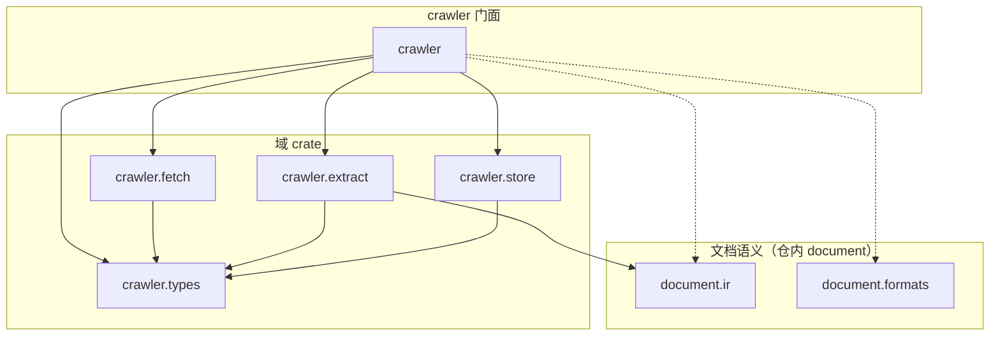
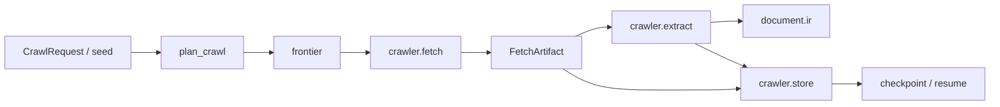
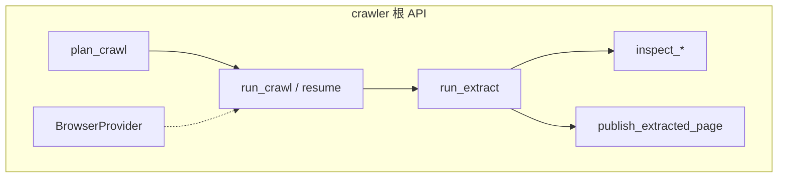
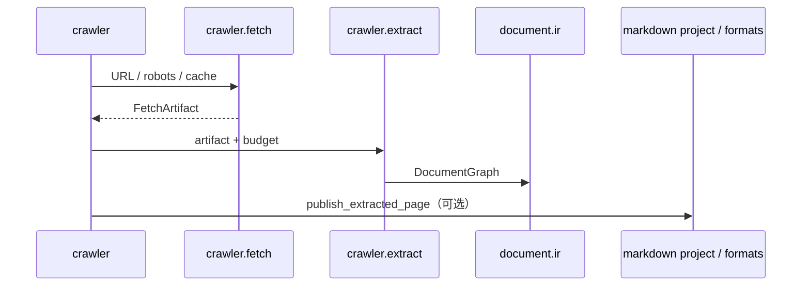

# Crawler

`projects/crawler/` 是 document.rs 里的**采集子系统**（原 Pandark 产品域）：抓取编排、传输、语义抽取与持久化，统一品牌 `crawler-*`，由门面 crate `crawler` 做稳定再导出。

本目录**只放 Rust 实现**。大型站点 fixtures、视觉/二进制黄金留在下游产品仓或 CI artifact；实现仓可保留文本合同 JSON。

## 1. 包图

目录名用点分层（`crawler.fetch`），Cargo package 名用连字符（`crawler-fetch`）。门面只做：

```rust
pub mod types { pub use crawler_types::*; }
pub mod fetch { pub use crawler_fetch::*; }
pub mod semantic { pub use crawler_extract::*; }
pub mod store { pub use crawler_store::*; }
// 根上另有 plan / crawl / extract / inspect 编排入口
```



| 目录 | Package | 职责 |
|---|---|---|
| `crawler` | `crawler` | 编排门面：plan / crawl / resume / extract / inspect / browser |
| `crawler.types` | `crawler-types` | `FetchArtifact`、frontier、报告、诊断 namespace `crawler` |
| `crawler.fetch` | `crawler-fetch` | HTTP / file / memory 传输、robots、响应缓存 |
| `crawler.extract` | `crawler-extract` | HTML → `document.ir` 语义抽取与 inspect |
| `crawler.store` | `crawler-store` | checkpoint / 页面事务 / memory & yydb 后端 |

诊断与 schema 合同（`1.0.0` 前 `/v0`）：

| 常量 | 值 |
|---|---|
| `NAMESPACE` | `crawler` |
| 报告 | `crawler.report/v0` |
| checkpoint | `crawler.checkpoint/v0` |
| inspect | `crawler.inspect/v0` |

## 2. 主链：seed → fetch → extract → store



### 2.1 编排职责（门面）



浏览器能力只走原生 `BrowserProvider`（fixture / HTTP / stack），不把 Node 运行时塞进本仓。

### 2.2 与 document 的边界



抽取产物落在 `document.ir`；发布 Markdown 工程等可再经 `document.formats` / convert。Plotter 不参与采集链。

## 3. 资产与下游边界

| 内容 | 归属 |
|---|---|
| 实现仓 Rust 测试 | **仅冒烟**（开库 / 缓存读写 / 编排烟测） |
| store 合同 JSON、doctor / 并发套件 | **下游** 产品仓 |
| 大型站点 fixtures / 二进制快照 | **下游**（`CRAWLER_FIXTURES`） |
| NAPI / CLI / npm 包装 | **下游**（原 pandark 产品仓） |

## 4. 本地开发

```bash
cargo check -p crawler -p crawler-types -p crawler-fetch -p crawler-extract -p crawler-store
cargo test -p crawler-types
cargo test -p crawler-fetch
cargo test -p crawler --lib
cargo test -p crawler-store --features yydb
```

Workspace 根 `Cargo.toml` 用 `projects/crawler/*` 收录本目录成员。门面说明见 [`crawler/readme.md`](crawler/readme.md)。
