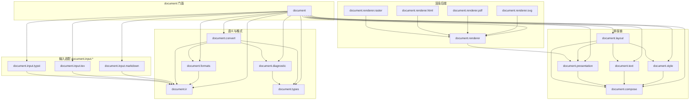
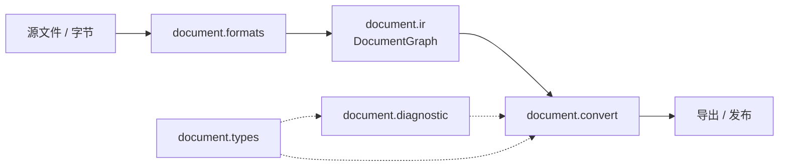
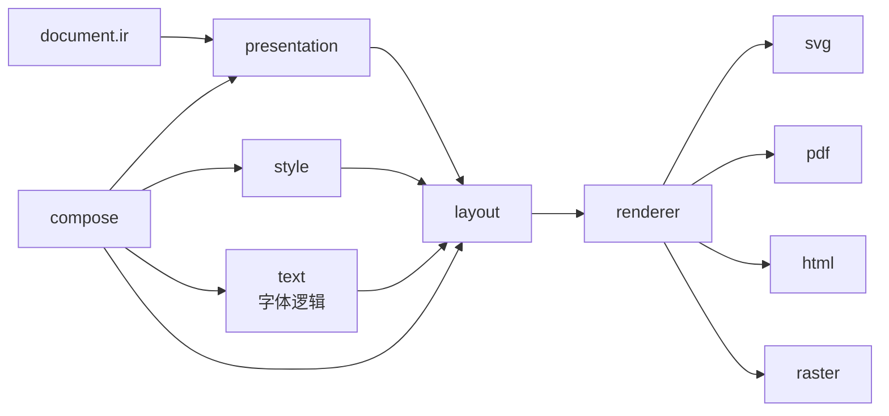
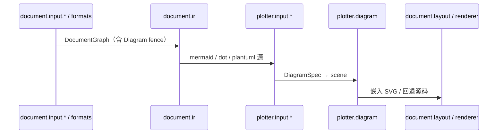

# Document

`projects/document/` 是 document.rs 里的**文档子系统**：语义 IR、格式 import/export、转换编排、排版（compose / style / text / layout / presentation）与多后端渲染，统一品牌 `document-*`，由门面 crate `document` 做稳定再导出。

本目录**只放 Rust 实现**。二进制字体（`.otf` / `.ttf`）、视觉 golden、大型 fixtures 属于下游产品仓（VuTeX 等），不进实现仓；字体**处理逻辑**（metrics / variants / MATH）留在 `document.text`。

## 1. 包图

目录名用点分层（`document.input.markdown`），Cargo package 名用连字符（`document-input-markdown`）。门面只做：

```rust
pub mod ir { pub use document_ir::*; }
pub mod formats { pub use document_formats::*; }
// …
pub mod input {
    pub mod markdown { pub use document_input_markdown::*; }
}
```



| 目录 | Package | 职责 |
|---|---|---|
| `document` | `document` | 门面，禁止在此写业务逻辑 |
| `document.ir` | `document-ir` | 文档语义 `DocumentGraph` |
| `document.formats` | `document-formats` | 多格式 import / export（feature 按语言打开） |
| `document.types` | `document-types` | 转换侧共享类型 / 源文本辅助 |
| `document.diagnostic` | `document-diagnostic` | 转换域诊断 |
| `document.convert` | `document-convert` | 读写编排、结构守卫、发布输出 |
| `document.compose` | `document-compose` | 排版侧共享 ID / 诊断 / 报告 |
| `document.style` | `document-style` | 语义样式与主题 |
| `document.text` | `document-text` | 字体处理与 shaping（**不含**字体字节） |
| `document.presentation` | `document-presentation` | 展示 / 流式 presentation IR |
| `document.layout` | `document-layout` | 分页与块 / 数学布局 |
| `document.renderer*` | `document-renderer{-svg,-pdf,-html,-raster}` | 后端合同与具体输出 |
| `document.input.*` | `document-input-{markdown,tex,typst}` | 语言入口适配，收敛到 IR |

## 2. 两条主链

### 2.1 格式 ↔ IR（转换）



`document.formats` 按 feature 打开 markdown / notedown / docx / html / tex / typst 等；`document.convert` 负责 reader/writer 编排与报告，不吞掉语义 IR。

### 2.2 IR → 排版 → 渲染



数学排版依赖 `document.text` 的 metrics / variants；字体文件由下游 `install_math_font` 注入。

### 2.3 输入适配与 Plotter 衔接



Diagram / Chart 的矢量编译在 `projects/plotter/`；本目录只保留文档语义与嵌入点。详见 [`../plotter/readme.md`](../plotter/readme.md)。

## 3. 资产与下游边界

| 内容 | 归属 |
|---|---|
| OpenType MATH 解析、metrics、variants | `document.text`（逻辑） |
| `.otf` / `.ttf` 字节 | **VuTeX 等下游** |
| 排版 / 渲染像素黄金 | **下游** 或 CI artifact |
| 文本合同（拒绝目录 JSON 等） | 可留在实现仓 |

## 4. 本地开发

```bash
cargo check -p document -p document-ir -p document-formats -p document-convert
cargo test -p document-ir
cargo test -p document-formats --features markdown
cargo test -p document-layout
```

Workspace 根 `Cargo.toml` 用 `projects/document/*` 收录本目录全部成员。门面 crate 说明见 [`document/readme.md`](document/readme.md)。
