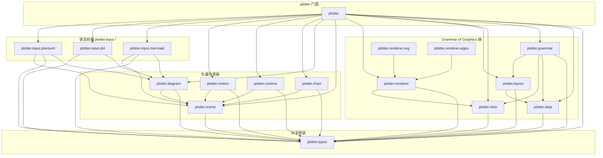
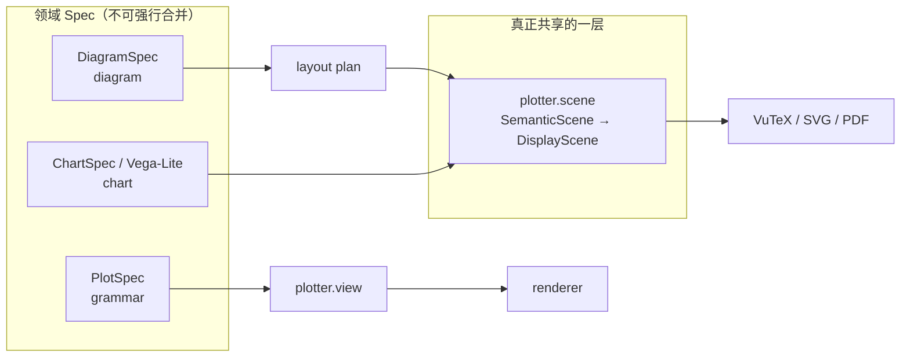
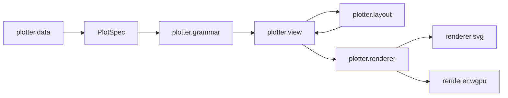
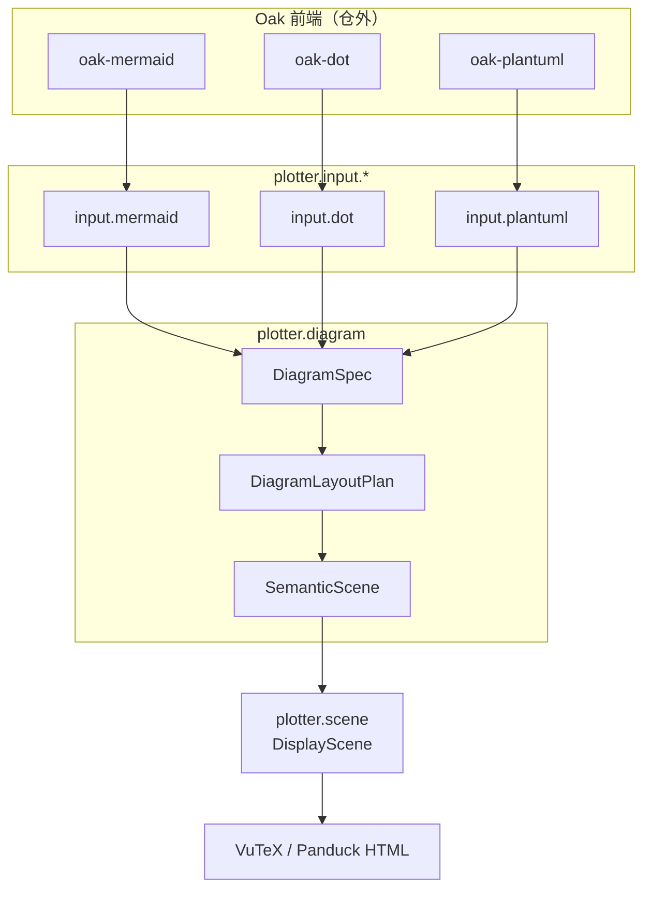
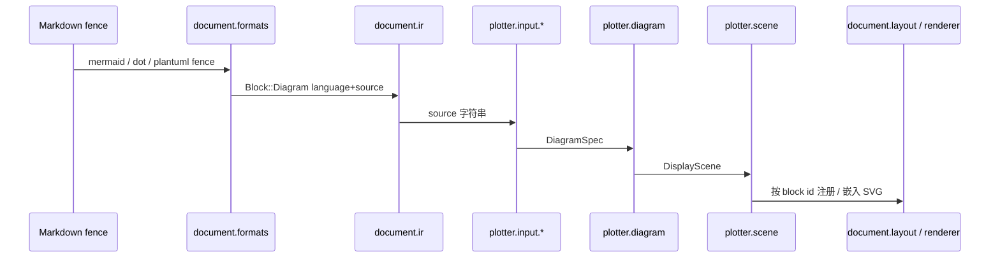

# Plotter

`projects/plotter/` 是 document.rs 里的 **绘图子系统**：Grammar of Graphics 绘图链与 Diagram / Chart 矢量链共用品牌
`plotter-*`，由门面 crate `plotter` 做稳定再导出。

本目录 **只放 Rust 实现**。二进制字体、视觉 golden（PNG / SVG / fingerprint）、大型 fixtures 属于下游产品仓
（VuTeX / 演示站），不进实现仓。

## 1. 包图

目录名用点分层（`plotter.input.mermaid`），Cargo package 名用连字符（`plotter-input-mermaid`）。门面只做：

```rust
pub mod types { pub use plotter_types::*; }
// …
pub mod input {
    pub mod mermaid { pub use plotter_input_mermaid::*; }
}
```



| 目录                                 | Package                              | 职责                                                                                                     |
|--------------------------------------|--------------------------------------|----------------------------------------------------------------------------------------------------------|
| `plotter`                            | `plotter`                            | 门面，禁止在此写业务逻辑                                                                                 |
| `plotter.types`                      | `plotter-types`                      | 共享几何 / 颜色 / 诊断；`types::plot` 为 GoG ID 与诊断（原 apollo-types，已并入，**无** `plotter.core`） |
| `plotter.data`                       | `plotter-data`                       | 表 / 图 / 树数据                                                                                         |
| `plotter.grammar`                    | `plotter-grammar`                    | `PlotSpec` → view 编译                                                                                   |
| `plotter.view`                       | `plotter-view`                       | GoG 的后端无关 Scene IR（Arena + 稳定 ID）                                                               |
| `plotter.layout`                     | `plotter-layout`                     | 面板与图/树布局                                                                                          |
| `plotter.renderer*`                  | `plotter-renderer{-svg,-wgpu}`       | CPU 合同与后端                                                                                           |
| `plotter.scene`                      | `plotter-scene`                      | 通用矢量 `SemanticScene` / `DisplayScene`                                                                |
| `plotter.diagram`                    | `plotter-diagram`                    | **只做** `DiagramSpec → plan → scene`，不含语言前端                                                      |
| `plotter.chart`                      | `plotter-chart`                      | 图表 / Vega-Lite，与 diagram 平行                                                                        |
| `plotter.runtime` / `plotter.motion` | `plotter-runtime` / `plotter-motion` | 交互与过渡                                                                                               |
| `plotter.input.mermaid`              | `plotter-input-mermaid`              | Oak Mermaid → `DiagramSpec`                                                                              |
| `plotter.input.dot`                  | `plotter-input-dot`                  | Oak DOT 白名单 → `DiagramSpec`                                                                           |
| `plotter.input.plantuml`             | `plotter-input-plantuml`             | Oak PlantUML 子集 → `DiagramSpec`                                                                        |

## 2. 为什么没有 `plotter.ir`

`document` 族有 `document.ir`（`notedown-ir`），因为文档语义是 **单一**中间表示。Plotter **不是**单一 IR：



| 候选                                                    | 结论                                                                                                       |
|---------------------------------------------------------|------------------------------------------------------------------------------------------------------------|
| 新建 `plotter.ir` 塞 `PlotSpec` + `DiagramSpec` + Chart | **不做**。Living 设计要求 graph / sequence / chart **平行**，强行共仓会泄漏语言私有字段、制造第二套文档 IR |
| 把 `plotter.scene` 改名叫 `plotter.ir`                  | **不做**。Scene 是**显示合同**，不是作者语义；改名只会与 `document.ir` 语义撞车                            |
| Spec 继续留在 `grammar` / `diagram` / `chart`           | **保持**。共享停在 `plotter.types` + `plotter.scene`                                                       |

一句话： **共享原语与矢量场景，不共享领域 Spec。**

## 3. 两条主链

### 3.1 Grammar of Graphics（绘图）



### 3.2 Diagram（图语言 → 矢量）

语言前端与编译管道分离：



Chart 不进上图：Vega-Lite 走 `plotter.chart`，与 diagram **零共享 Spec**，只共享 `plotter.types` / `plotter.scene`。

### 3.3 与 document 的衔接



失败时保留 fence 原文与结构化诊断，宿主回退可见源码，不空白、不静默丢弃。

## 4. `plotter.types` 内部结构

原 apollo-types **并入** `plotter.types`，不设 `plotter.core`：

```text
plotter.types
├── （根）几何 Color / Point / Rect / 诊断 / theme   ← 原 davinci-types
└── plot::                         ← 原 apollo-types
      Rgba, NodeId, DiagnosticCode, Interval, …
```

根上的 `Diagnostic` / `Color` 与 `plot::Diagnostic` / `plot::Rgba` 刻意分模块，避免 GoG 与 diagram 诊断模型撞名。

## 5. 资产与下游边界

| 内容                                        | 归属                                             |
|---------------------------------------------|--------------------------------------------------|
| OpenType MATH 解析、metrics、variants       | `document` 侧字体处理 crate（逻辑）              |
| `.otf` / `.ttf` 字节                        | **VuTeX 等下游**（`install_math_font` 注入）     |
| diagram/chart 视觉 golden、PNG、fingerprint | **下游** 或 CI artifact，不进 `projects/plotter` |
| 合同 JSON（如拒绝目录）                     | 可留在 `plotter.types`（文本合同，非像素资产）   |

## 6. 本地开发

```bash
cargo test -p plotter-diagram
cargo test -p plotter-input-mermaid
cargo test -p plotter-chart --features vega-lite
cargo test -p plotter
```

Workspace 根 `Cargo.toml` 用 `projects/plotter/*` 收录本目录全部成员。
